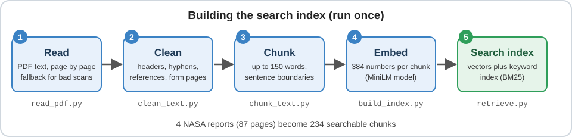
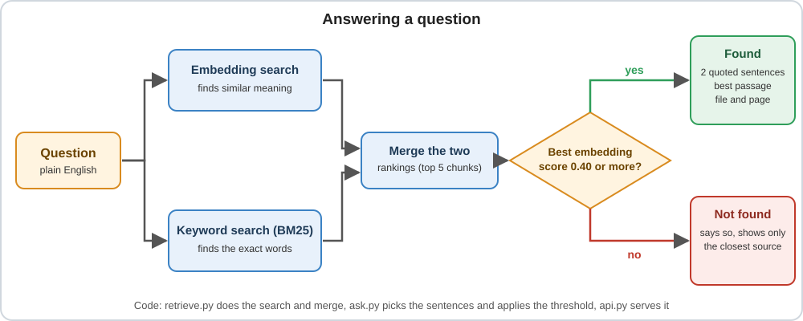

# turbine-docs-rag

Ask a question about four NASA reports on engine sensors and health monitoring, and get back the sentences that answer it, with the file and page they came from. If the reports don't cover the question, it says so instead of guessing.

I built this to practise the parts of ML work that tutorials skip: messy PDFs, checking whether search really works, and knowing when to say "I don't know".

A real question and the answer it gives:

<pre>
Question: What is the pinch point in turbine tip clearance?

"This results in the condition of least tip clearance within a flight mission,
which is called pinch point."    (20100029602.pdf, page 11)
</pre>

## At a glance

| What | Result |
|---|---|
| Documents | 4 NASA reports (87 pages), cut into 234 searchable chunks |
| Search | Meaning (embeddings) and exact words (BM25) combined. The answer is in the top 5 results for 57 of my 65 test questions |
| "I don't know" | Rejects all 9 off-topic test questions and still answers 95% of the answerable ones |
| Service | FastAPI, with a health check and an ask endpoint |
| Tests | 28 unit tests |

## How it works

The reports are read once and turned into searchable pieces. After that, every question is searched two ways at the same time, and the results are merged.

A few things I had to deal with along the way:

- One report is a scan from 1985. My first PDF reader turned 19.5% of its words into stray single letters. If that happens, the code now retries with a second reader, and the scan came out at 1.2%.
- The reports end with reference lists and a government form. They only add noise to search, so I cut them. That took the chunk count from 272 to 234.
- Chunks are up to 150 words, split on sentence boundaries, and never cross a page. That keeps the page number in every citation correct.
- There is no language model here. The answer is two sentences quoted from the reports, so nothing is made up. It also means the answers are not always as good as a model's would be (more on that below).

The embedding model is all-MiniLM-L6-v2, which turns text into 384 numbers so that similar meanings end up close together. BM25 is the classic keyword scoring method. The two rankings are merged with a simple method called reciprocal rank fusion: each chunk gets points for how high each method ranked it, and the points are added up. The answer is "not found" when the best embedding score is below 0.40.

## Data

Four public NASA technical reports. They are not stored in this repository, so you have to download them.

| File | Report |
|---|---|
| 20100025863.pdf | NASA/TM-2010-216736, a microwave blade tip clearance sensor for propulsion health monitoring |
| 20100015448.pdf | NASA/TM-2010-216239, crack detection experiments on simulated turbine engine disks |
| 20100029602.pdf | NASA/TM-2010-216746, sensor and actuator needs for more intelligent gas turbine engines |
| 19850018596.pdf | Reusable rocket engine turbopump condition monitoring (1985 paper, scanned) |

Once the data\raw folder exists (step 4 of "Run it yourself" below), open PowerShell in the project folder and run these four commands. They save the files in data\raw.

<pre>
Invoke-WebRequest -Uri "https://ntrs.nasa.gov/api/citations/20100025863/downloads/20100025863.pdf" -OutFile "data\raw\20100025863.pdf"
Invoke-WebRequest -Uri "https://ntrs.nasa.gov/api/citations/20100015448/downloads/20100015448.pdf" -OutFile "data\raw\20100015448.pdf"
Invoke-WebRequest -Uri "https://ntrs.nasa.gov/api/citations/20100029602/downloads/20100029602.pdf" -OutFile "data\raw\20100029602.pdf"
Invoke-WebRequest -Uri "https://ntrs.nasa.gov/api/citations/19850018596/downloads/19850018596.pdf" -OutFile "data\raw\19850018596.pdf"
</pre>

## Run it yourself

I used Windows and Python 3.14. Run everything from the project folder.

### 1. Install

1. Create a virtual environment: <code>py -m venv venv</code>
2. Activate it: <code>venv\Scripts\activate</code>
3. Install the packages: <code>pip install pymupdf pdfplumber sentence-transformers rank-bm25 fastapi uvicorn httpx pytest</code>
4. Make the folder for the reports: <code>mkdir data\raw</code>
5. Download the four reports with the commands above.

### 2. Build the search index

1. Read the PDFs: <code>python src\read_pdf.py</code>
2. Clean the text: <code>python src\clean_text.py</code>
3. Cut it into chunks: <code>python src\chunk_text.py sentences</code>
4. Turn the chunks into embeddings: <code>python src\build_index.py sentences</code>

The first run of step 4 downloads the embedding model (about 90 MB), so you need an internet connection.

### 3. Ask something

1. In the terminal: <code>python src\ask.py "What is the pinch point in turbine tip clearance?"</code>
2. Or start the web service: <code>python -m uvicorn api:app --app-dir src</code>
3. Wait about 15 seconds, until it prints "Application startup complete".
4. Open http://127.0.0.1:8000/docs in a browser.
5. Click POST /ask, then Try it out, put in a body like {"question": "What is the pinch point in turbine tip clearance?"} and click Execute.
6. Stop the service with Ctrl+C.
7. Run the tests (28 of them): <code>python -m pytest -q</code>

A question the reports can't answer comes back with found false, no sentences, and only the single closest source.

## Does the search work?

I wanted numbers, not a feeling. So I built a test set. Each question has a phrase from the reports that the right answer must contain. A result counts if it comes from the right report and contains that phrase.

The questions were drafted with Claude's help (more on that in "How I built it"). The first set had 40 questions. They were written with the reports open, so they reuse the reports' own words, and that favours keyword search. So I added 25 more questions about the same facts in different words.

Results with sentence chunks. Hit@5 is the share of questions with the answer in the top 5 results. MRR@10 is higher when the answer is ranked higher.

| Method | 40 questions: hit@5 | MRR@10 | 25 reworded: hit@5 | MRR@10 |
|---|---|---|---|---|
| Embeddings | 90% | 0.648 | 68% | 0.590 |
| BM25 keyword search | 98% | 0.843 | 52% | 0.416 |
| Hybrid | 98% | 0.775 | 72% | 0.602 |

What I took from it:

- Keyword search is great when you use the report's words and falls apart when you don't (98% down to 52%). Embeddings drop less. Using both was the safest choice: over all 65 questions the hybrid has the answer in the top 5 for 57, against 53 for embeddings and 52 for keywords.
- The very first passage has the answer for 39 of the 65 questions (60%), and the top 3 passages for 51 (78%).
- I compared sentence-based chunks with plain 150 word windows. They scored the same (57 of 65 each), so I kept the sentence chunks because they read better.

To repeat all of this, run these in order:

1. <code>python src\chunk_text.py words</code>
2. <code>python src\build_index.py words</code>
3. <code>python src\evaluate_methods.py sentences sentences_methods</code>
4. <code>python src\evaluate_methods.py sentences sentences_paraphrased questions_paraphrased.json</code>
5. <code>python src\evaluate_methods.py words words_methods</code>
6. <code>python src\evaluate_methods.py words words_paraphrased questions_paraphrased.json</code>
7. <code>python src\calibrate_threshold.py</code>
8. <code>python src\evaluate_answers.py</code>

## Saying "I don't know"

Search always returns something, even for a question about bread. So I added a minimum score. To pick it, I added 20 questions the reports can't answer: 9 off-topic ones (like "How do I bake sourdough bread at home?") and 11 that sound close to the topic (like "What is the price of a Siemens gas turbine?").

At a threshold of 0.40 the system keeps 95% of the answerable questions and rejects all 9 off-topic ones. It only rejects 3 of the 11 close-to-topic ones, because their scores overlap with real questions. A score alone can't tell those apart.

## Where it falls short

- It quotes sentences, it doesn't write answers. The two quoted sentences contain the answer for about 54% of my questions (52% to 60%, depending on a weight I tried). For 77% of them the answer was somewhere in the top 3 chunks. So the weak step is picking the sentence, not finding the passage. A language model reading those chunks should do better, and that is my next step.
- The test is small: 65 questions on 4 documents. A difference of one or two questions is noise.
- I chose the 0.40 threshold using the same questions I measured it on, so its numbers are a bit optimistic.
- Tables and figures aren't read. Page 6 of the 1985 scan is a table stored as an image, so it's dropped.
- In one report the text layer stores "approximately" as a dash. An answer can end up saying "at -8000 rpm" when the report says "about 8000 rpm".
- Joining words that were split across lines sometimes joins real hyphenated words. "Thirty-two" became "Thirtytwo".

## How I built it

I built this with Claude as a tutor and pair programmer. It explained each step and wrote the first version of the code, and I ran everything on my own machine, checked answers against the PDFs, and sorted out what broke. The test questions were also drafted with its help. I checked a sample by hand against the reports. After the first run I changed four answer labels (three to accept another correct passage, one reworded), and I read each change in the source first. The first results are still in data/eval.

## What's in the repository

| Stage | File | What it does |
|---|---|---|
| Prepare the data | <code>src/read_pdf.py</code> | PDF to text, page by page |
| | <code>src/inspect_text.py</code> | measures text problems |
| | <code>src/clean_text.py</code> | cleaning rules |
| | <code>src/chunk_text.py</code> | sentence and word chunking |
| | <code>src/build_index.py</code> | embeddings |
| Search and answer | <code>src/retrieve.py</code> | hybrid search |
| | <code>src/ask.py</code> | answers with citations and the not-found check |
| | <code>src/api.py</code> | FastAPI service |
| Evaluate | <code>src/evaluate.py</code> | scores embedding search |
| | <code>src/evaluate_methods.py</code> | embeddings, BM25 and hybrid compared |
| | <code>src/evaluate_answers.py</code> | how often the answer sentence is picked |
| | <code>src/calibrate_threshold.py</code> | picks the not-found threshold |
| | <code>src/check_results.py</code> | checks results against expected numbers |
| | <code>src/debug_query.py</code> | ranks a page's chunks for a question |
| Tests and data | <code>tests/</code> | unit tests |
| | <code>data/eval/</code> | question sets and saved results |
| | <code>docs/</code> | the two diagrams above |
| | <code>pytest.ini</code> | test settings |

## What I want to do next

- Add a language model that reads the top passages and writes the answer, still showing the quoted sources.
- Try adding the document title and section heading to each chunk, and returning neighbouring chunks. Some questions are missed by every method I tried.
- Add a Dockerfile.